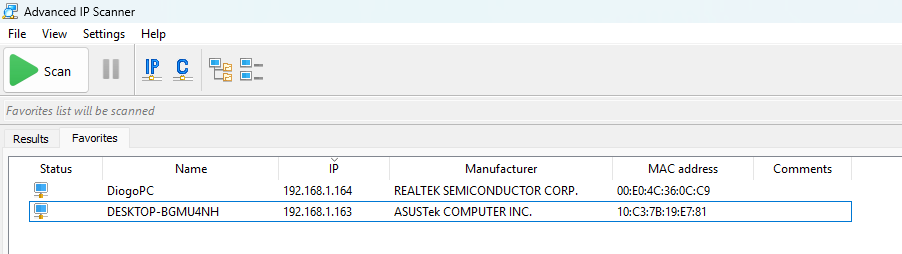
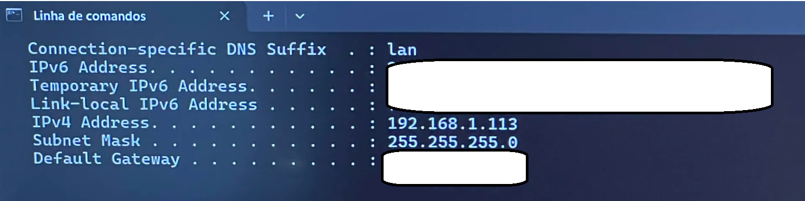
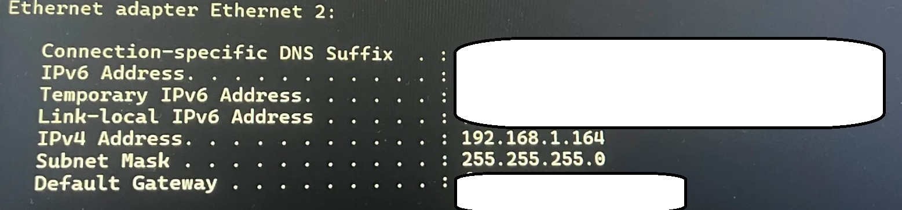

# Teste de conectividade base

Antes de qualquer segmentação, foi confirmado que os dois PCs de teste
têm conectividade entre si e endereçamento atribuído pelo router. Este é
o ponto de referência contra o qual os testes seguintes (VLANs,
mirroring, QoS) vão ser comparados.

## Varredura da rede

O Advanced IP Scanner confirma que os dois PCs de teste estão vivos e
alcançáveis na mesma rede.

## Endereçamento dos PCs

Ambos os PCs obtiveram endereço por DHCP a partir do router, confirmando
que o switch gerível está a comportar-se de forma transparente — a
encaminhar tráfego como qualquer switch não-gerível, sem qualquer
segmentação ativa.

**PC 1:**

**PC 2:**

## Nota sobre o ping

Os testes de ping entre dispositivos Windows não devolvem resposta
devido à configuração padrão do Windows Defender Firewall, que bloqueia
pedidos ICMP de entrada. Esta é uma limitação do sistema operativo, não
da rede — o Advanced IP Scanner e o endereçamento DHCP confirmam que os
dois PCs são alcançáveis ao nível da camada 2.
