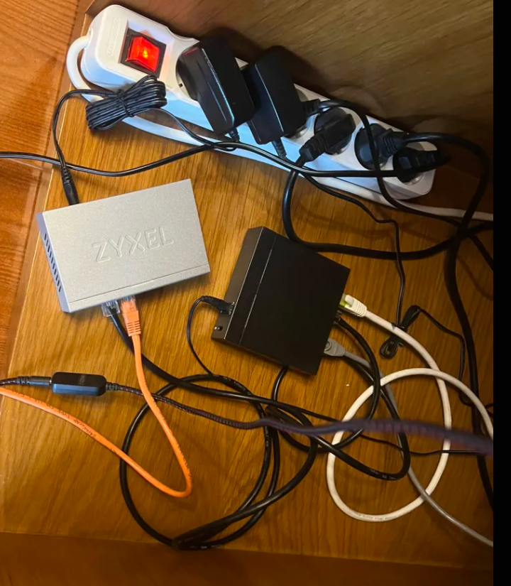
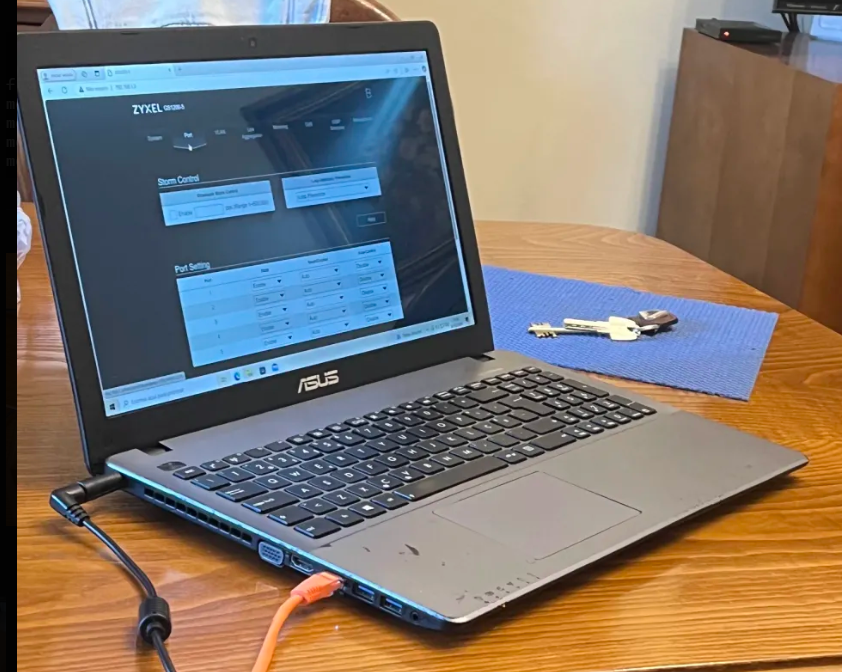

# Montagem física

O switch gerível está inserido a jusante do Switch 2, sem alterar o Switch 1
nem a rede doméstica original. Os dois portáteis de teste estão ligados
diretamente ao switch gerível, para que todo o tráfego entre eles passe
por ele — e não pela rede doméstica.

## Intuito da montagem

Esta disposição é intencional e serve o objetivo do projeto:

- **Switch 2 → switch gerível** — o switch gerível recebe a rede doméstica
  através do Switch 2, mas não interfere com o resto da casa.
- **Portáteis ligados ao switch gerível** — os dois clientes de teste ficam
  ambos ligados ao mesmo switch, para que os ensaios de segmentação (VLANs),
  espelhamento de tráfego (mirroring) e priorização (QoS) aconteçam
  exclusivamente dentro dele.

Ao manter os portáteis fora do Switch 2 e do Switch 1, os testes ficam
isolados do resto da rede doméstica — mesmo quando mais tarde forem
criadas VLANs no switch gerível, nada do que acontece nestas portas afeta
os outros dispositivos da casa.

## Portas usadas

| Porta do switch gerível | Ligada a | Notas |
|---|---|---|
| Porta 1 | Switch 2 | Ligação para cima (upstream) |
| Porta 2 | Portátil 1 | Cliente de teste principal |
| Porta 3 | Portátil 2 | Cliente de teste secundário |
| Portas 4–5 | — | Livres (reservadas para mirroring e link aggregation) |

## Fotos

**Switch gerível ligado** — ligação ao Switch 2.

**Portátil 1 ligado** — cliente de teste principal ligado ao switch gerível.

