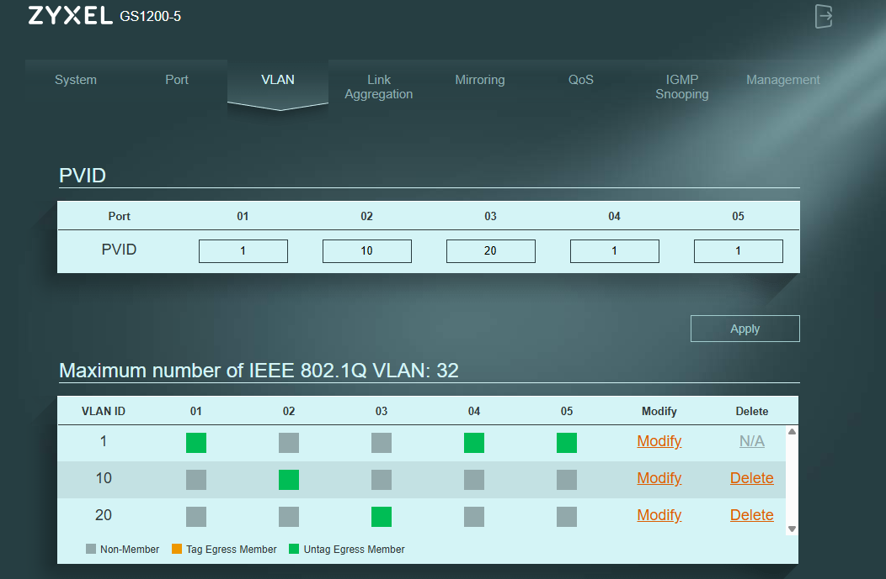

# Segmentação com VLANs

O switch gerível foi configurado com três VLANs distintas, cada uma com o
mínimo de portas necessárias. Este teste demonstra que dois dispositivos
ligados ao mesmo switch físico, em portas adjacentes, podem ser
completamente isolados por configuração — algo que um switch não-gerível
nunca conseguiria fazer.

## Configuração aplicada

| Porta | PVID | VLAN | Ligada a |
|---|---|---|---|
| Porta 1 | 1 | VLAN 1 | Switch 2 (upstream) |
| Porta 2 | 10 | VLAN 10 | Portátil 1 |
| Porta 3 | 20 | VLAN 20 | Portátil 2 |
| Porta 4 | 1 | VLAN 1 | Livre |
| Porta 5 | 1 | VLAN 1 | Livre |

Cada porta pertence apenas à sua VLAN. Não há tráfego cruzado entre
VLANs, nem acesso à VLAN 1 (rede doméstica) a partir das VLANs 10 e 20.

## Efeito nos dispositivos

Antes da segmentação, ambos os portáteis recebiam endereço IP do router
via DHCP (na VLAN 1). Após a criação das VLANs 10 e 20, deixaram de ter
acesso ao router — cada um ficou isolado na sua VLAN, com um endereço
link-local atribuído automaticamente pelo sistema operativo.

**Portátil 1 (VLAN 10):**

**Portátil 2 (VLAN 20):**

## Resultado

- ✅ Os dois portáteis perderam acesso ao router e à rede doméstica
- ✅ Cada um ficou isolado na sua VLAN
- ✅ Os dois não se conseguem ver entre si (VLANs diferentes)
- ✅ O PC fixo (na VLAN 1) deixou de os ver na rede
- ✅ A GUI do switch continua acessível a partir da VLAN 1

O isolamento é total. Do ponto de vista de cada portátil, o outro não
existe — apesar de ambos estarem ligados ao mesmo switch físico, em
portas adjacentes.
