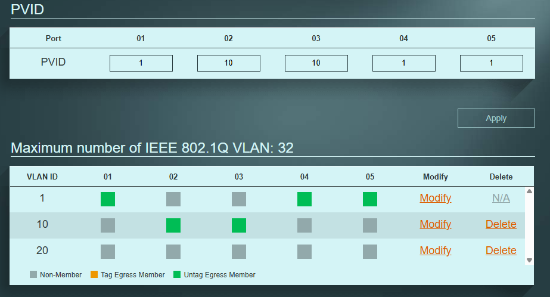

# Acesso mútuo entre portáteis na mesma VLAN

Teste complementar: os dois portáteis foram colocados na mesma VLAN
(VLAN 10), com IPs fixos na mesma sub-rede, para provar que a
comunicação entre eles funciona normalmente dentro da VLAN — incluindo
partilha de ficheiros via SMB.

## Configuração das VLANs

Ambas as portas na mesma VLAN:

## Atribuição dos IPs fixos

Os IPs foram atribuídos via linha de comando (CMD como Administrador),
para que ambos os portáteis ficassem na mesma sub-rede (`10.0.0.0/24`):
 

