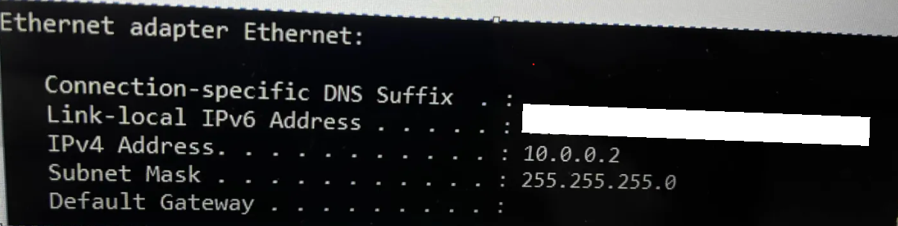
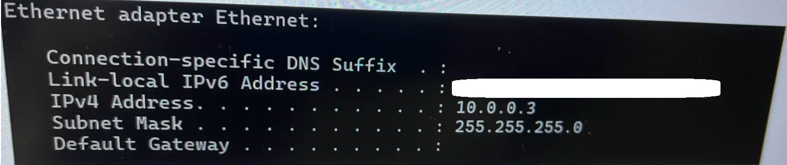
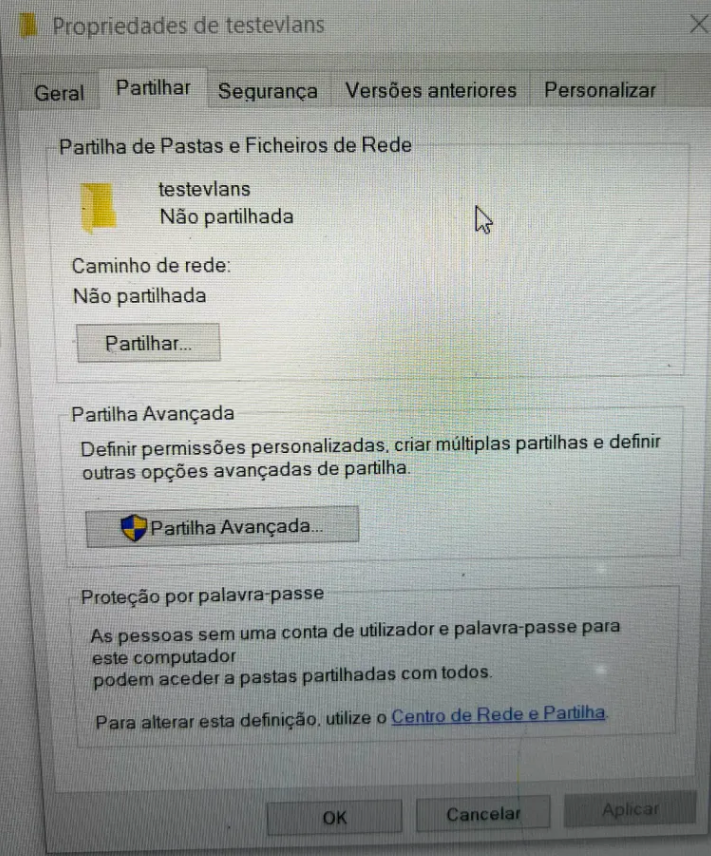
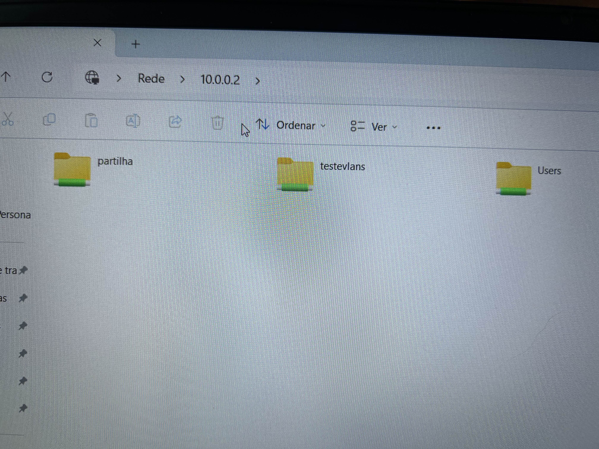
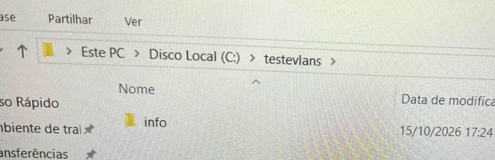

# Acesso mútuo entre portáteis na mesma VLAN

Teste complementar: os dois portáteis foram colocados na mesma VLAN
(VLAN 10), com IPs fixos na mesma sub-rede, para provar que a
comunicação entre eles funciona normalmente dentro da VLAN — incluindo
partilha de ficheiros via SMB.

## Configuração das VLANs

Ambas as portas na mesma VLAN:

## Atribuição dos IPs fixos

Cada portátil recebeu um IP fixo na mesma sub-rede (`10.0.0.0/24`), para
que a comunicação entre eles não dependesse de DHCP (que não existe
nesta VLAN isolada). O comando é o mesmo, mudando apenas o endereço IP
final.

**No Portátil 1** (`.2`):
netsh interface ip set address name="Ethernet" static 10.0.0.2 255.255.255.0

**No Portátil 2** (`.3`):
netsh interface ip set address name="Ethernet" static 10.0.0.3 255.255.255.0

A única diferença entre os comandos é o endereço IP atribuído
(`10.0.0.2` no Portátil 1, `10.0.0.3` no Portátil 2) e o facto de cada
um ter sido executado na sua própria máquina.

### IPs configurados

**Portátil 1** (`10.0.0.2`):

**Portátil 2** (`10.0.0.3`):

## Preparação da partilha de ficheiros

Para testar a comunicação entre os dois portáteis, foi criada uma pasta
partilhada no Portátil 1, com um utilizador dedicado (`smbtest`),
autenticado por password.

Comandos usados no Portátil 1 (CMD como Administrador):
mkdir C:\testevlans
net user smbtest Teste123 /add
net share testevlans=C:\testevlans /grant:smbtest,FULL

**Pasta criada:**

**Permissões atribuídas ao utilizador `smbtest`:**

## Testes de acesso a partir do Portátil 2

A partir do Portátil 2, foi testado o acesso às partilhas do Portátil 1
através do Explorador de Ficheiros.

**Acesso à partilha anterior (`partilha`):**

**Criação de uma pasta `info` dentro da partilha `testevlans`, a partir
do Portátil 2:**

**Confirmação no Portátil 1 — a pasta `info` criada remotamente está
visível localmente:**

## Resultado

- ✅ Os dois portáteis, na mesma VLAN, comunicam entre si
- ✅ A partilha de ficheiros via SMB funciona entre eles
- ✅ Ficheiros e pastas criados remotamente aparecem no outro portátil
- ✅ Não é necessária internet nem router para esta comunicação
- ✅ O isolamento da VLAN mantém-se face ao resto da rede (VLAN 1)

Isto demonstra que uma VLAN, apesar de isolar os dispositivos do resto da
rede, mantém a comunicação interna totalmente funcional — exatamente o
comportamento pretendido em ambientes segmentados.
