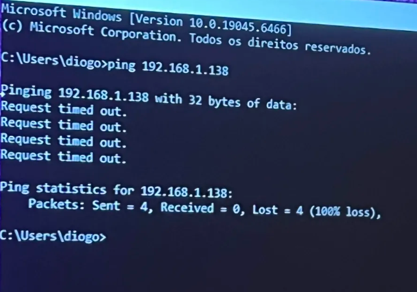
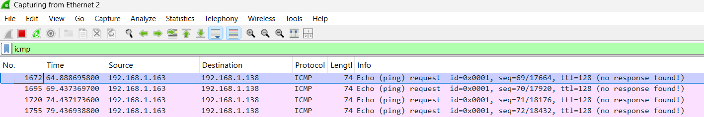

# Teste 1 — ICMP (ping)

Captura de tráfego de ping gerado pelo PC ligado à porta espelhada (porta 4) e visto pelo PC na porta de monitorização (porta 2).

## O que foi feito
Do PC na porta 4, foram feitos pings contínuos a dois dispositivos da rede (o PC fixo e o robô de limpeza). O PC na porta 2 registou os pacotes ICMP.

**Comando usado no PC da porta 4 (ping ao PC fixo `.138`):**

**Captura no Wireshark (PC da porta 2 a ver o ping ao `.138`):**

