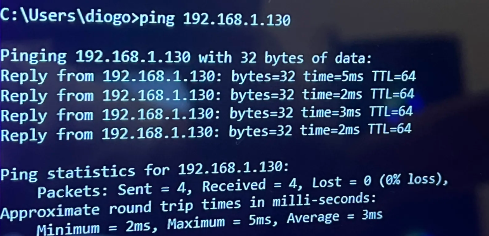
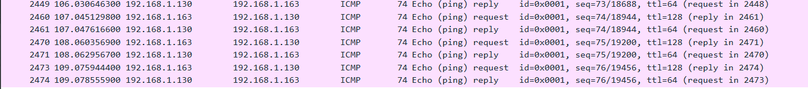

# Teste 1 — ICMP (ping)

Captura de tráfego de ping gerado pelo PC ligado à porta espelhada (porta 4) e visto pelo PC na porta de monitorização (porta 2).

## O que foi feito
Do PC na porta 4 (`.163`), foram feitos pings contínuos a dois dispositivos diferentes da rede. O PC na porta 2 (`.164`) registou os pacotes ICMP de ambos os testes.

## Teste A — Ping ao PC fixo (`.138`)

**Comando no CMD (PC da porta 4):**

**Captura no Wireshark (PC da porta 2):**

*O que o print significa:* O Wireshark mostra os pedidos (`Echo request`) a sair do `.163` com destino ao `.138`. A indicação `(no response found!)` acontece porque o firewall do Windows bloqueou a resposta. No entanto, o espelhamento funcionou perfeitamente, pois o PC monitor conseguiu ver os pacotes enviados.

## Teste B — Ping ao robô de limpeza (`.130`)

**Comando no CMD (PC da porta 4):**

**Captura no Wireshark (PC da porta 2):**

*O que o print significa:* O Wireshark mostra os pedidos (`Echo request`) do `.163` para o `.130`. Tal como no teste A, prova que o tráfego do dispositivo espelhado chega ao dispositivo monitor.

## Conclusão
O Wireshark capturou todos os pacotes ICMP do PC espelhado. O PC da porta de monitorização não fazia parte dessas conversas — recebeu apenas as cópias espelhadas.
