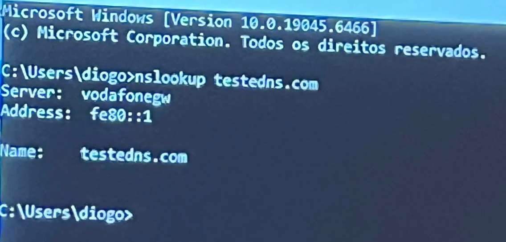
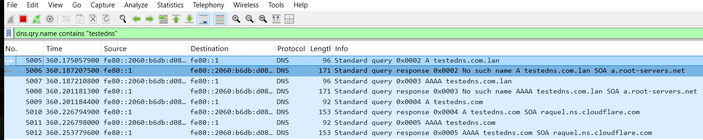

# Teste 2 — DNS

Captura de tráfego DNS gerado pelo PC ligado à porta espelhada (porta 4) e visto pelo PC na porta de monitorização (porta 2).

## O que foi feito
Do PC na porta 4 (`.163`), foi usado o comando `nslookup` para forçar uma consulta DNS a um domínio específico. O PC na porta 2 (`.164`) registou os pacotes DNS.

**Comando no CMD (PC da porta 4):**

**Captura no Wireshark (PC da porta 2):**

*O que o print significa:* O `nslookup` pede ao router para resolver o nome `testedns.com`. O Wireshark no PC monitor capturou a query (`Standard query A testedns.com`) e a resposta, provando que o tráfego DNS também é espelhado com sucesso.

## Conclusão
Tal como no teste de ICMP, o Wireshark capturou todo o tráfego DNS do PC espelhado. O PC da porta de monitorização recebeu as cópias espelhadas, sem interferir na comunicação original.
