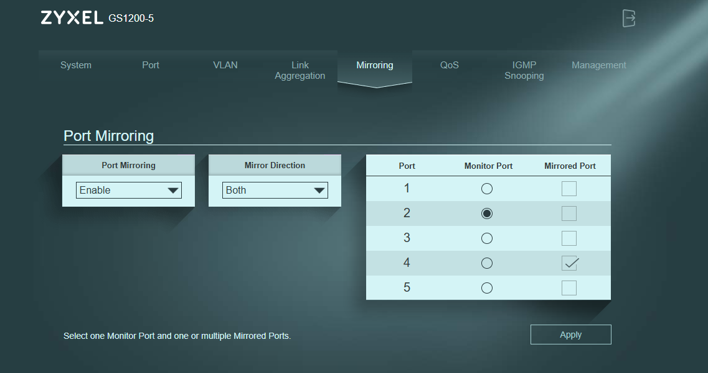

# Port Mirroring

O port mirroring permite que um dispositivo veja todo o tráfego de uma porta específica do switch, sem fazer parte dessa comunicação. Esta funcionalidade é a base de ferramentas de monitorização, análise de tráfego e deteção de intrusões.

## Configuração aplicada

O switch gerível foi configurado para espelhar todo o tráfego da porta 4 para a porta 2:

- **Mirrored Port:** porta 4 (PC que gera o tráfego)
- **Monitor Port:** porta 2 (PC que captura com Wireshark)
- **Direction:** Both (entrada e saída)

## Testes realizados

Foram feitos dois testes para validar o funcionamento do port mirroring, documentados em pastas separadas:

1. **Teste 1 — ICMP (ping):** captura de tráfego de ping, confirmando que o PC monitor recebe as cópias dos pacotes ICMP enviados pelo PC espelhado. (Ver pasta `01-teste-ping/`)

2. **Teste 2 — DNS:** captura de consultas DNS usando o comando `nslookup`, mostrando que a resolução de nomes também é visível no PC monitor. (Ver pasta `02-teste-dns/`)
