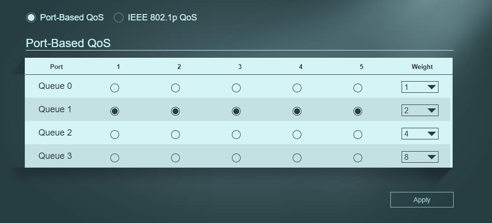
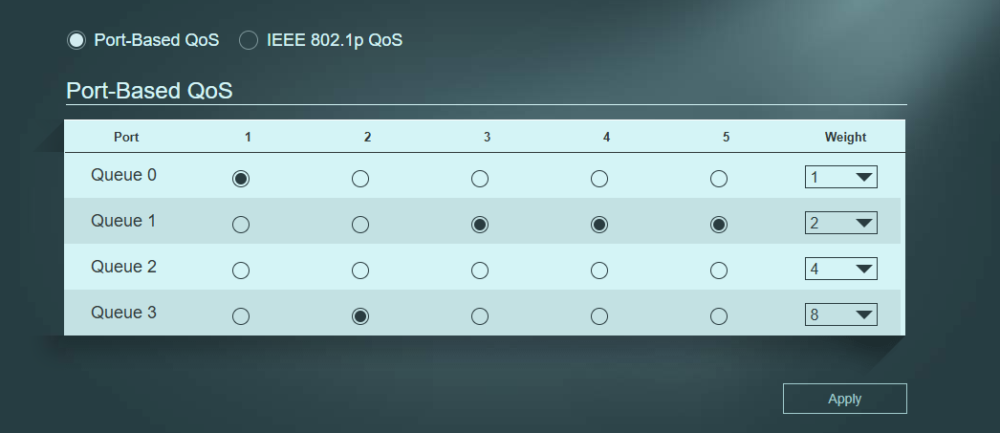
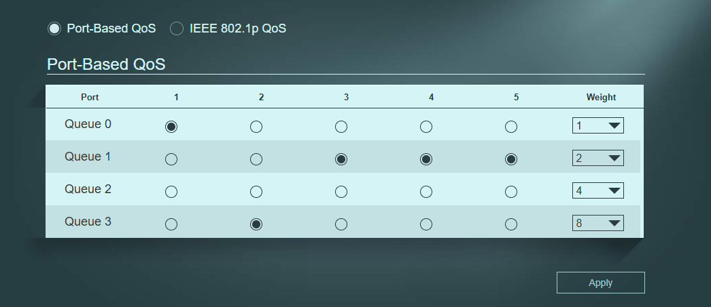

# QoS (Prioridade de Tráfego)

O QoS permite ao switch decidir qual o tráfego que tem prioridade quando a rede está congestionada. Este teste demonstra a diferença entre uma rede sem prioridade e uma rede com prioridade configurada.

## O Setup do Teste

Para forçar o congestionamento, dois PCs (emissores) enviam tráfego ao mesmo tempo para um terceiro PC (recetor). A porta do recetor é o gargalo (limite de ~95 Mbps).
*   **PC .163** → Porta 2 do switch (Emissor)
*   **PC Fixo .138** → Porta 1 do switch (Emissor)
*   **PC .164** → Porta 4 do switch (Recetor)

---

## Teste 1: Sem QoS (Configuração Default)

Todas as portas estão na Queue 1 (peso 2). O switch divide a largura de banda de forma igual.

**Resultados do iperf3:**
*   **PC .163:** 47.2 Mbits/sec
*   **PC .138:** 48.0 Mbits/sec
*(Divisão de 50% / 50%).*

* [Ver print do resultado do .163](02-antes-163.png)
* [Ver print do resultado do .138](03-antes-138.png)

---

## Teste 2: Com QoS (Peso 8 vs Peso 2)

A porta do .163 foi colocada na Queue 3 (peso 8) e a porta do .138 manteve-se na Queue 1 (peso 2). O switch agora vai dar 80% da banda ao .163.

**Resultados do iperf3:**
*   **PC .163:** 76.4 Mbits/sec
*   **PC .138:** 19.1 Mbits/sec
*(Divisão de 80% / 20%, exatamente como a fórmula do switch prevê).*

* [Ver print do resultado do .163](05-depois-163.png)
* [Ver print do resultado do .138](06-depois-138.png)

---

## Teste 3: Com QoS (Peso 8 vs Peso 1) - Extremo

Para provar que o switch respeita os limites, a porta do .138 foi descida para a Queue 0 (peso 1). A diferença entre as filas torna-se ainda mais brutal.

**Resultados do iperf3:**
*   **PC .163:** 82.5 Mbits/sec (Aproximou-se dos 89% teóricos)
*   **PC .138:** 10.6 Mbits/sec (Caiu para os 11% teóricos)

* [Ver print do resultado do .163](08-final-163.png)
* [Ver print do resultado do .138](09-final-138.png)

---

## Conclusão

A configuração do QoS no switch gerível está comprovada. Ao alterar as filas (Queues), o switch alterou a distribuição da largura de banda de forma proporcional aos pesos configurados. O limite total da rede manteve-se, mas a fatia de cada PC mudou drasticamente, provando que a prioridade de tráfego está a funcionar.
