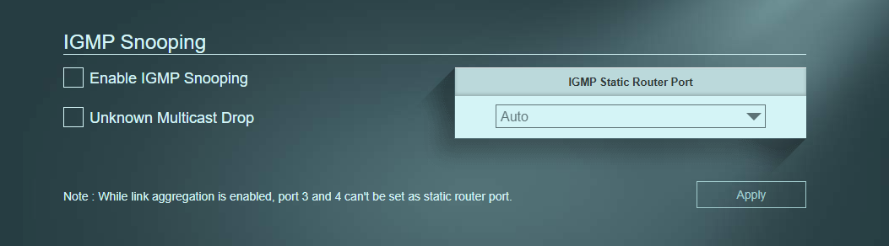
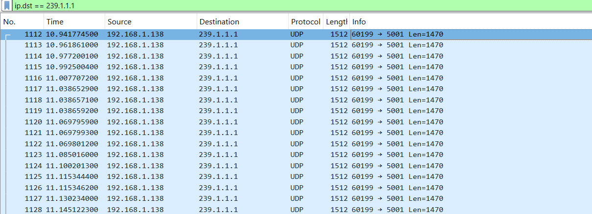
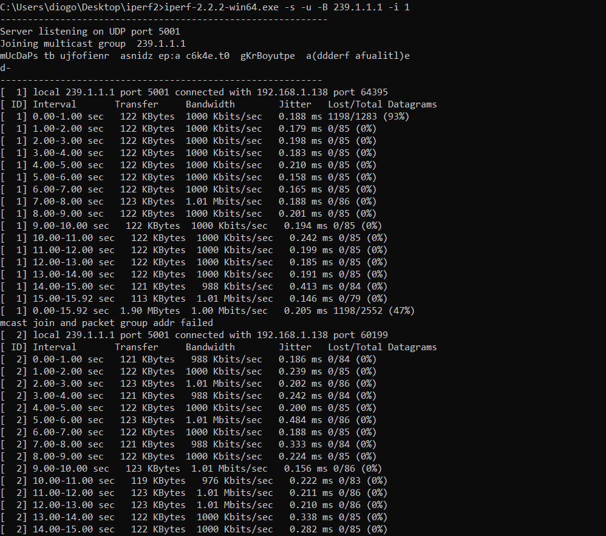

# IGMP Snooping Desligado

O IGMP Snooping permite ao switch saber quem quer receber tráfego multicast. Sem ele, o switch inunda todas as portas com o tráfego, mesmo que os dispositivos não o tenham pedido.

## Configuração do Switch
- Enable IGMP Snooping: Desligado
- Unknown Multicast Drop: Desligado

## O Emissor (PC Fixo .138)
O PC Fixo foi configurado para enviar tráfego multicast para o grupo `239.1.1.1`.

## O Observador (Portátil B .164)
O Portátil B não pediu para entrar no grupo, mas como o Snooping está desligado, o switch inunda a rede e ele consegue ver todo o tráfego.

## O Recetor Oficial (Portátil A .163)
O Portátil A juntou-se ao grupo e recebeu os dados.

## Conclusão
Com o IGMP Snooping desligado, o tráfego multicast é entregue a todos os dispositivos da rede, mesmo aos que não o pediram. Isto representa um desperdício de largura de banda e um problema de segurança.
