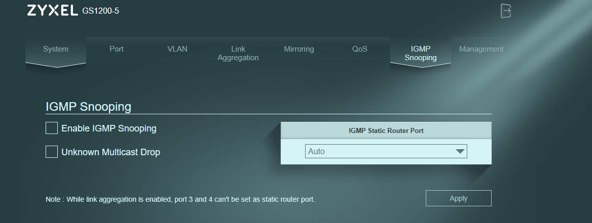
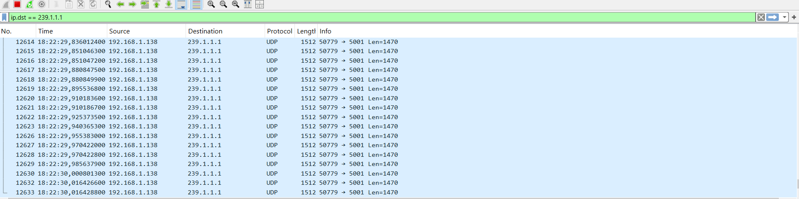
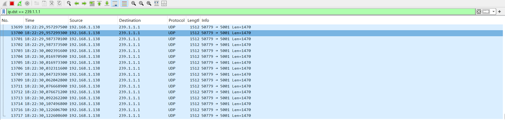

# IGMP Snooping Desligado

O IGMP Snooping permite ao switch entregar o tráfego multicast apenas aos dispositivos que o pediram. Sem ele, o switch inunda todas as portas, mesmo que os dispositivos não o tenham pedido.

## Configuração do Switch
- Enable IGMP Snooping: Desligado
- Unknown Multicast Drop: Desligado

## O Emissor (PC Fixo .138)
O PC Fixo enviou o tráfego multicast para o grupo `239.1.1.1`.

## O Recetor Oficial (Portátil A .163)
O Portátil A correu o comando no CMD e juntou-se ao grupo.

## O Wireshark do Portátil A
Como o switch está a inundar a rede, o Wireshark do A vê os pacotes.

## O Observador (Portátil B .164)
O Portátil B também vê o tráfego no Wireshark, **mesmo sem ter pedido o grupo**. Isto acontece porque o snooping está desligado e o switch entrega o tráfego a todos.

## Conclusão
Com o IGMP Snooping desligado, o tráfego multicast é inundado por toda a rede. O Portátil B, que não pediu o grupo, continua a receber os dados, o que representa um desperdício de largura de banda e um problema de segurança.
