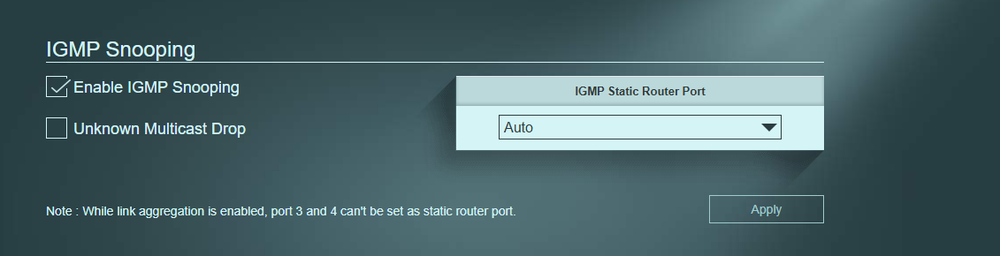
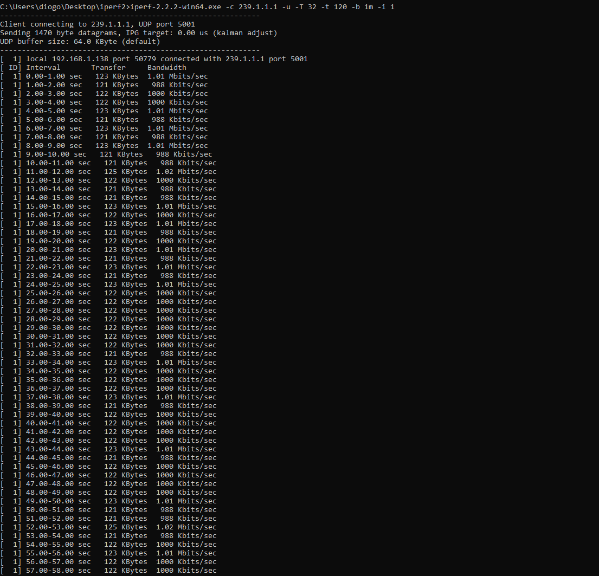
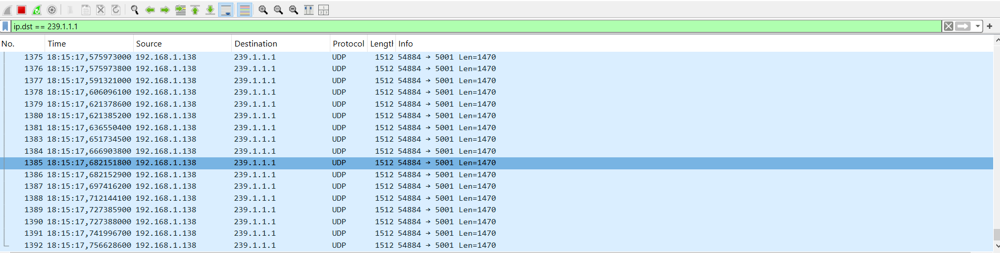
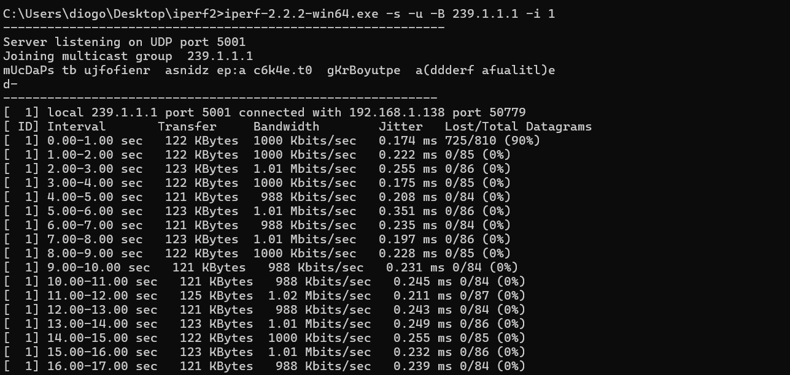
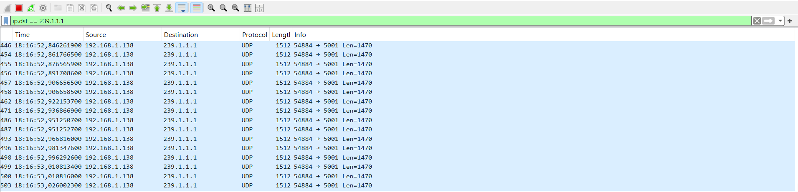

# IGMP Snooping Ligado (A Prova com Timestamps)

O IGMP Snooping permite ao switch entregar o tráfego multicast **apenas** aos dispositivos que o pediram. Este teste prova, através dos tempos de captura (timestamps), a diferença de comportamento em relação ao teste anterior.

## Configuração do Switch
- Enable IGMP Snooping: Ligado
- Unknown Multicast Drop: Desligado

## O Emissor (PC Fixo .138)
O PC Fixo enviou o tráfego multicast para o grupo `239.1.1.1`.

## O Observador Cortado (Portátil A .163)
O Portátil A tentou espiar o tráfego apenas com o Wireshark, sem ter pedido o grupo via CMD. 

Inicialmente, o A estava a receber os pacotes. No entanto, quando o Portátil B (que pediu o grupo) se juntou, o switch cortou o acesso ao A. O Wireshark do A mostra o tráfego a parar, e a hora em que o A parou **não se sobrepõe** à hora em que o B começou.

## O Recetor (Portátil B .164)
O Portátil B correu o comando no CMD e juntou-se ao grupo.

Como o B pediu o grupo, o switch entregou-lhe o tráfego. O Wireshark do B registou os pacotes a partir do momento em que ele se juntou.

## Conclusão
Com o Snooping ligado, o switch deixou de inundar a rede. Quando o Portátil B fez o pedido, o switch começou a entregar o tráfego apenas a ele e cortou o acesso ao A (que não pediu). Isto prova que o switch está a entregar o tráfego multicast de forma seletiva, apenas a quem o pede.
