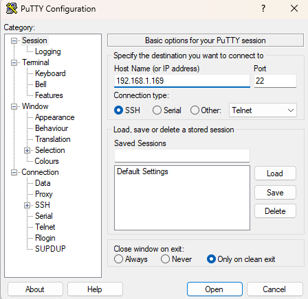
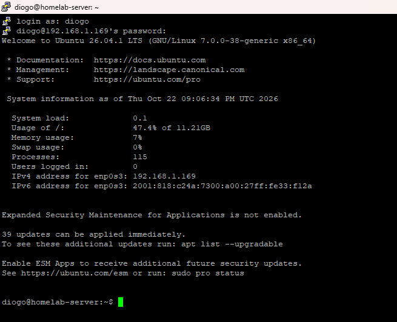
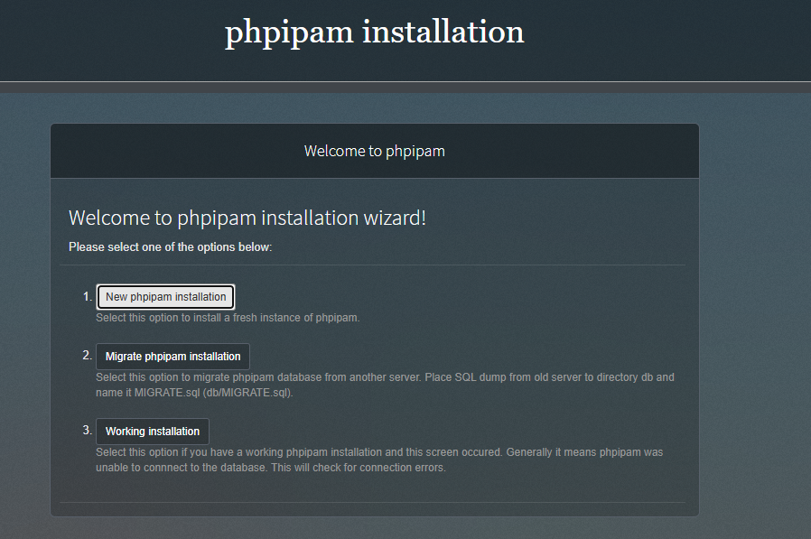
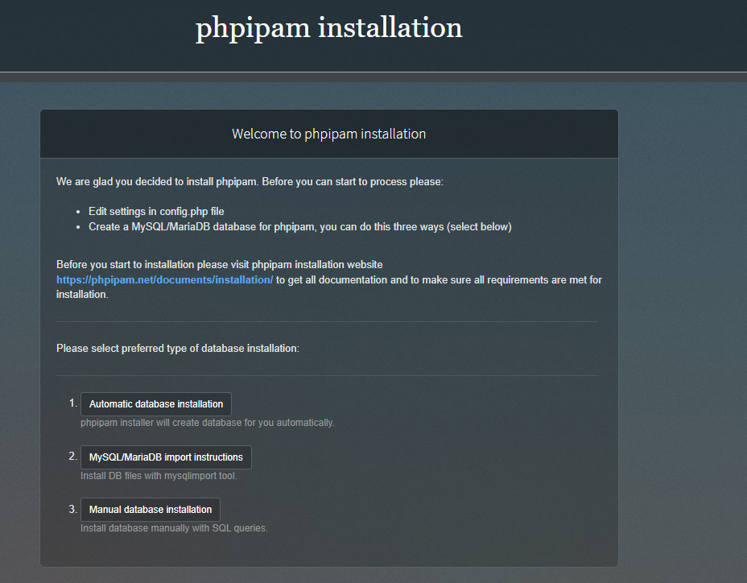
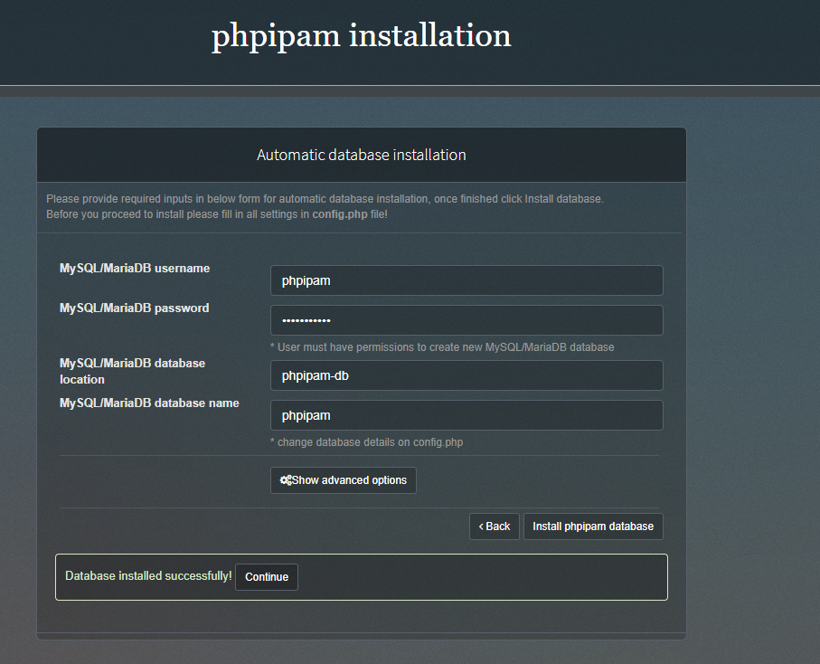
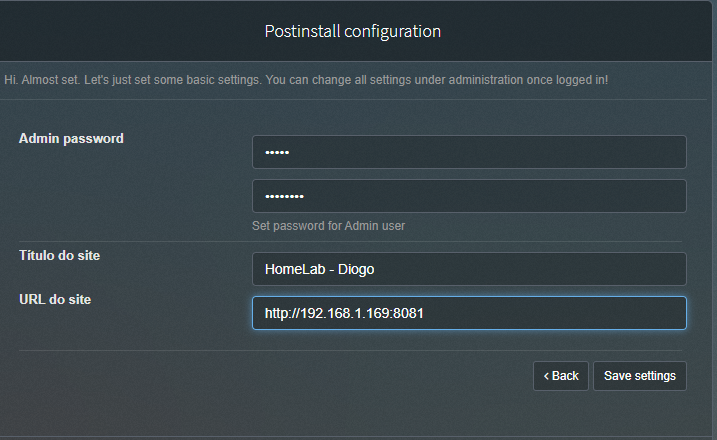
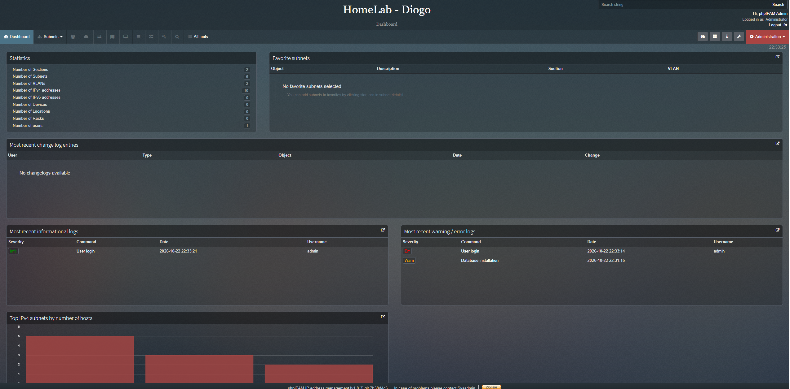

# phpIPAM (Gestão de IPs)

O phpIPAM é uma aplicação web de código aberto para gestão de endereçamento IP (IPAM - IP Address Management). Permite documentar sub-redes, endereços IP utilizados e dispositivos da rede, evitando conflitos de IPs e facilitando a gestão da infraestrutura.

A aplicação foi instalada no servidor virtualizado (Ubuntu Server) através do Docker, utilizando o Docker Compose para orquestrar dois containers: um para a aplicação web e outro para a base de dados (MariaDB).

## Acesso ao Servidor (SSH via PuTTY)

A instalação foi feita remotamente a partir do PC Fixo, usando o PuTTY para aceder ao terminal do Ubuntu Server através de SSH.

## Criação do Docker e Docker Compose

### Porquê o Docker?
Em vez de instalar o phpIPAM e a base de dados diretamente no Ubuntu (o que poderia gerar conflitos de versões e dependências), optou-se pelo Docker. O Docker permite empacotar cada aplicação com todas as suas dependências num "container" isolado. O Docker Compose é a ferramenta que lê um ficheiro de configuração e levanta vários containers ao mesmo tempo, ligando-os automaticamente numa rede virtual privada.

### Comandos de Instalação
Os comandos abaixo foram executados no terminal do Ubuntu (via SSH).

    sudo apt update && sudo apt upgrade -y
    sudo apt install -y docker.io docker-compose-v2 git
    sudo systemctl enable --now docker
    sudo usermod -aG docker $USER

*(Após estes comandos, o utilizador saiu e voltou a entrar na sessão SSH para aplicar as permissões).*

## Configuração do Container (docker-compose.yml)

O ficheiro `docker-compose.yml` foi criado na pasta `~/homelab/phpipam`. Este ficheiro define a arquitetura do serviço.

### O código de criação do container

    services:
      phpipam-db:
        image: mariadb:10.11
        environment:
          MYSQL_ROOT_PASSWORD: rootpass
        volumes:
          - phpipam_db_data:/var/lib/mysql
        restart: unless-stopped

      phpipam-web:
        image: phpipam/phpipam-www:1.6
        ports:
          - "8081:80"
        environment:
          TZ: Europe/Lisbon
          IPAM_DATABASE_HOST: phpipam-db
          IPAM_DATABASE_USER: phpipam
          IPAM_DATABASE_PASS: phpipampass
          IPAM_DATABASE_NAME: phpipam
        depends_on:
          - phpipam-db
        restart: unless-stopped

    volumes:
      phpipam_db_data:

### Utilidade de cada bloco:
*   **`phpipam-db`**: Define o container da base de dados usando a imagem oficial do MariaDB. A diretiva `volumes` garante que os dados não são perdidos se o container for reiniciado.
*   **`phpipam-web`**: Define o container da aplicação web. A diretiva `ports: "8081:80"` mapeia a porta 80 interna do container para a porta 8081 do servidor virtualizado, permitindo o acesso a partir do browser do PC Fixo. A diretiva `depends_on` garante que a base de dados arranca antes da aplicação web.
*   **`volumes`**: Declara o volume para o Docker saber onde guardar os dados de forma persistente.

## Arranque e Gestão dos Serviços

Para arrancar os containers em segundo plano:

    cd ~/homelab/phpipam
    docker compose up -d
    docker compose ps

*(Durante o arranque, o Docker descarregou as imagens e criou a rede virtual entre eles).*

## Evidências da Instalação

O processo de instalação foi feito através do browser no PC Fixo, acedendo a `http://192.168.1.169:8081`.

**1. Ecrã de boas-vindas do instalador:**

**2. Escolha do tipo de instalação da base de dados:**

**3. Base de dados instalada com sucesso:**

**4. Configuração pós-instalação (password e URL):**

**5. Dashboard final do phpIPAM:**

## Conclusão

O phpIPAM está acessível em `http://192.168.1.169:8081` e o dashboard confirma a instalação bem-sucedida.
