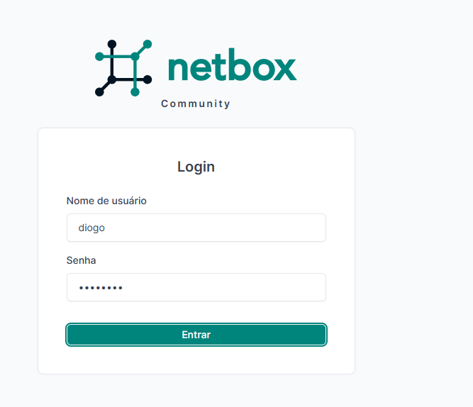
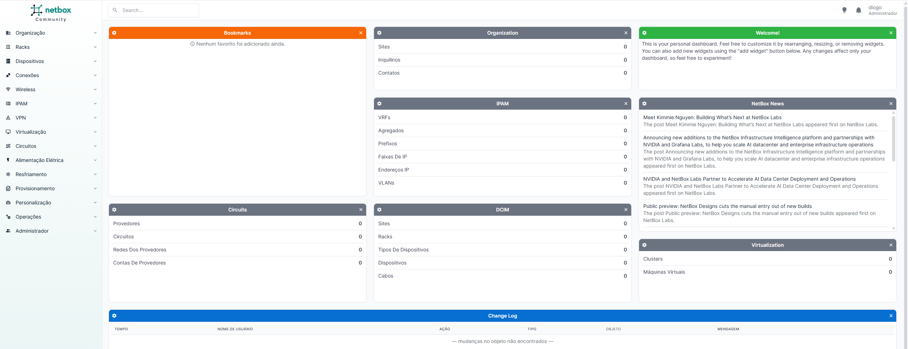

# NetBox (Documentação de Infraestrutura)

O NetBox é uma aplicação web de código aberto para documentação de infraestrutura de rede (IPAM e DCIM). Permite documentar redes, racks, dispositivos, cabos e endereços IP. É a ferramenta padrão da indústria para gestão de infraestrutura.

## Instalação

O NetBox foi instalado no servidor virtualizado (Ubuntu Server) usando o repositório oficial do Docker, através do comando:

    git clone -b release https://github.com/netbox-community/netbox-docker.git

Foi criado o ficheiro de configuração docker-compose.override.yml para mapear a porta 8000 e ajustar o healthcheck do container (para dar mais tempo de arranque na primeira instalação):

    services:
      netbox:
        ports:
          - "8000:8080"
        healthcheck:
          start_period: 300s

O NetBox necessita de três containers interligados:
*   netbox-docker-netbox-1: A aplicação web.
*   netbox-docker-postgres-1: A base de dados (PostgreSQL).
*   netbox-docker-redis-1 e redis-cache-1: O sistema de cache (Redis).

## Arranque e Configuração

Os containers foram descarregados e arrancados com:

    docker compose pull
    docker compose up -d

O utilizador administrador do NetBox foi criado através do seguinte comando:

    docker compose exec netbox /opt/netbox/netbox/manage.py createsuperuser

## Acesso e Evidências

O acesso é feito através do browser no PC Fixo, no endereço http://192.168.1.169:8000.

1. Ecrã de Login:

2. Dashboard principal (com o painel de gestão de IPAM, DCIM e Virtualização):

## Conclusão

O NetBox está instalado e funcional, provando a capacidade de correr serviços complexos e interligados (web, base de dados e cache) num ambiente Docker dentro de uma máquina virtual.
