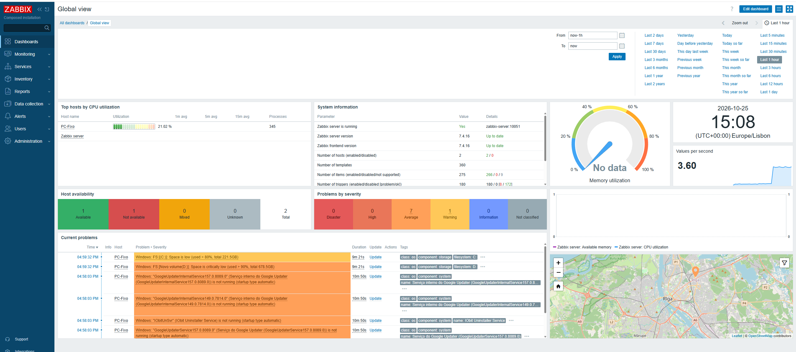
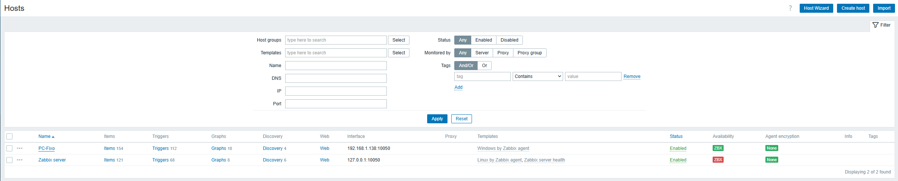
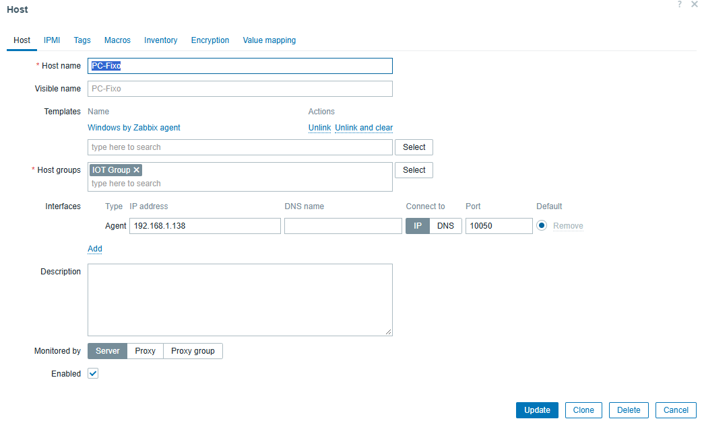
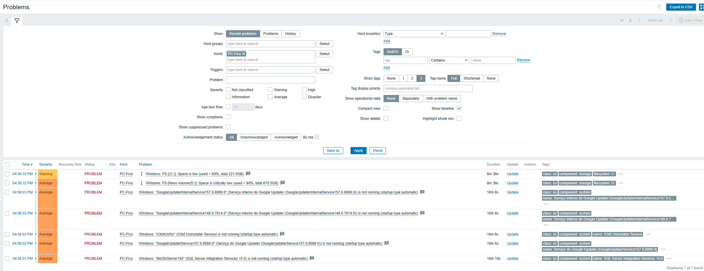

# Zabbix (Monitorização e Alertas)

O Zabbix é uma plataforma de monitorização de redes e servidores. A sua função neste homelab foi acompanhar o estado dos dispositivos e recolher métricas detalhadas do sistema operativo, gerando alertas automáticos quando algo falha.

## Instalação do Zabbix Server (Docker)

O servidor Zabbix foi instalado na máquina virtual (Ubuntu) via Docker. Para não colidir com o NetBox (porta 8080) e o phpIPAM (porta 8081), a interface web do Zabbix foi mapeada para a porta 8082.

```bash
cd ~/homelab
git clone https://github.com/zabbix/zabbix-docker.git
cd zabbix-docker
git checkout 7.4
```

Foi criado um ficheiro de overrides para forçar a porta:

```yaml
cat << 'EOF' > docker-compose.override.yaml
services:
  zabbix-web-nginx-mysql:
    ports:
      - "8082:8080"
EOF
```

O arranque foi feito com:

```bash
docker compose -f compose.yaml -f docker-compose.override.yaml up -d
```

## A Descoberta do PC Fixo (Zabbix Agent)

Esta foi a parte mais importante do projeto. Inicialmente, o Zabbix apenas sabia que o PC Fixo existia na rede (via ping). Para obter informações internas do PC (CPU, RAM, Disco), foi instalado o Zabbix Agent no PC Fixo (Windows).

O Agente é um serviço que corre em segundo plano no PC e comunica com o servidor Zabbix na porta 10050. Através dele, o Zabbix "descobriu" e passou a monitorizar métricas como a utilização do processador (CPU), memória RAM, espaço em disco e tráfego de rede.

A comunicação entre a VM e o Agente do Windows foi testada e validada com sucesso.

## Monitorização de Dispositivos IoT

Para além do PC Fixo, foram configurados no Zabbix dois dispositivos domésticos:

* Robo-Limpeza (192.168.1.130)
* Maquina-Lavar (192.168.1.172)

Como estes dispositivos não correm Windows nem Linux, não é possível instalar o Agente. A monitorização é feita através do template "Template Module ICMP Ping", que verifica se eles estão ligados à rede.

## Evidências

1. Dashboard principal do Zabbix:

   

2. Lista de Hosts monitorizados (PC Fixo, Robô e Máquina de Lavar):

   

3. Configuração do Host PC-Fixo:

   

4. Alertas de problemas:

   

## Conclusão

O Zabbix está a monitorizar ativamente o PC Fixo (com métricas profundas via Agente) e os dispositivos IoT (via Ping). A capacidade de gerar alertas foi validada, provando que o sistema de monitorização está a funcionar na perfeição.
