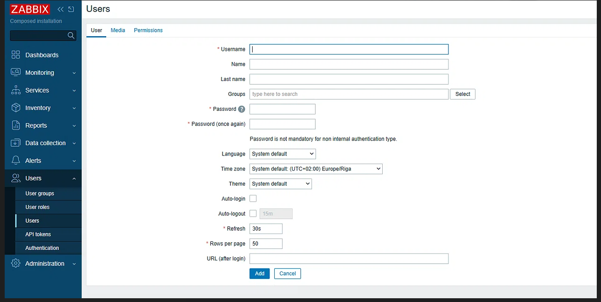
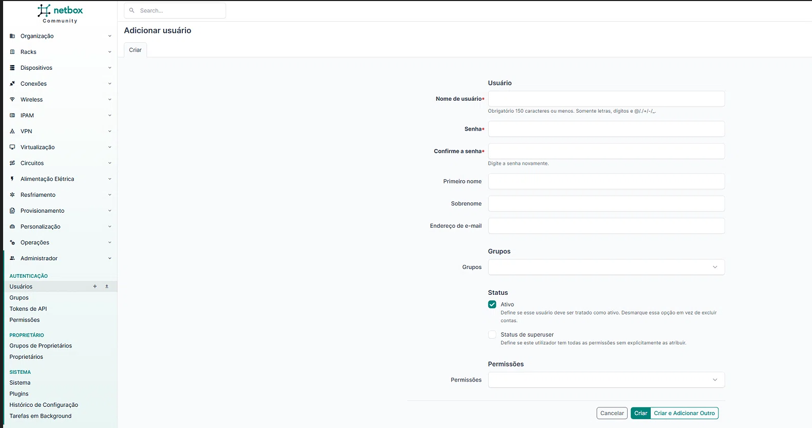
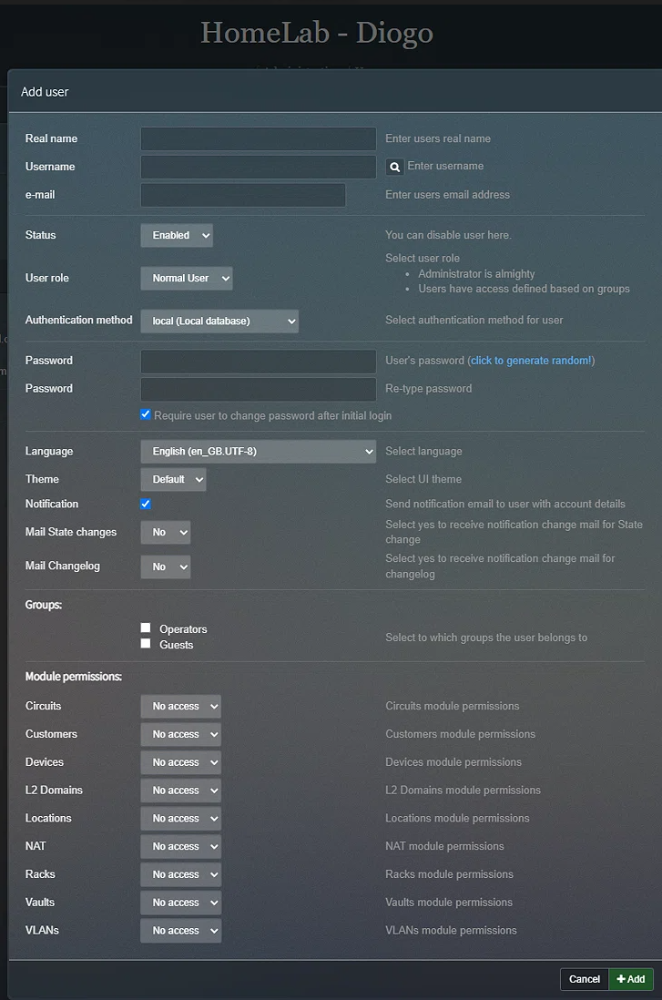

# Gestão de Utilizadores (Simulação de Operadores)

O objetivo foi simular dois operadores diferentes a aceder à infraestrutura de rede. Para isso, foram criados dois utilizadores novos para serem usados nos dois portáteis, em cada uma das aplicações (Zabbix, NetBox e PHPipam).

## O Intuito das Roles (Privilégios)

O intuito de definir roles diferentes foi aplicar o Princípio do Menor Privilégio, garantindo que cada operador tem apenas os acessos necessários para a sua função:

*   **Zabbix:** O utilizador foi criado com a Role de "User role". O intuito é permitir que os operadores consultem o estado da rede e os gráficos, sem lhes dar permissões para alterar configurações do sistema.
*   **NetBox:** O utilizador foi criado com o "Status de superuser" desmarcado. O intuito é permitir a consulta e documentação, mas evitar que apaguem dados críticos da base de dados.
*   **PHPipam:** O utilizador foi criado com a Role de "Administrator". O intuito é permitir que os operadores criem e documentem os endereços IP da rede, o que exige permissões de escrita.

## Evidências

**Zabbix: Criação do utilizador:**

**Zabbix: Atribuição da Role de User:**

**NetBox: Criação do utilizador sem superuser:**

**phpIPAM: Criação do utilizador:**

## Conclusão
A criação de contas separadas para os diferentes portáteis permite simular um ambiente real com múltiplos operadores. A atribuição de diferentes níveis de privilégio (Role) para cada ferramenta demonstra uma correta aplicação das boas práticas de segurança de redes.
