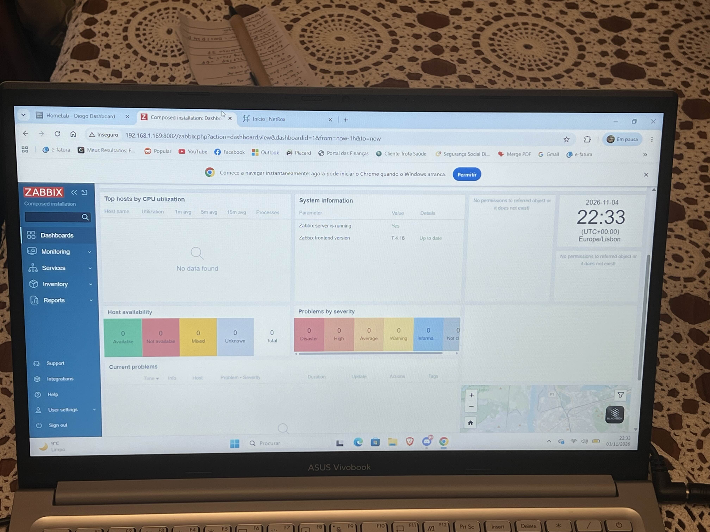
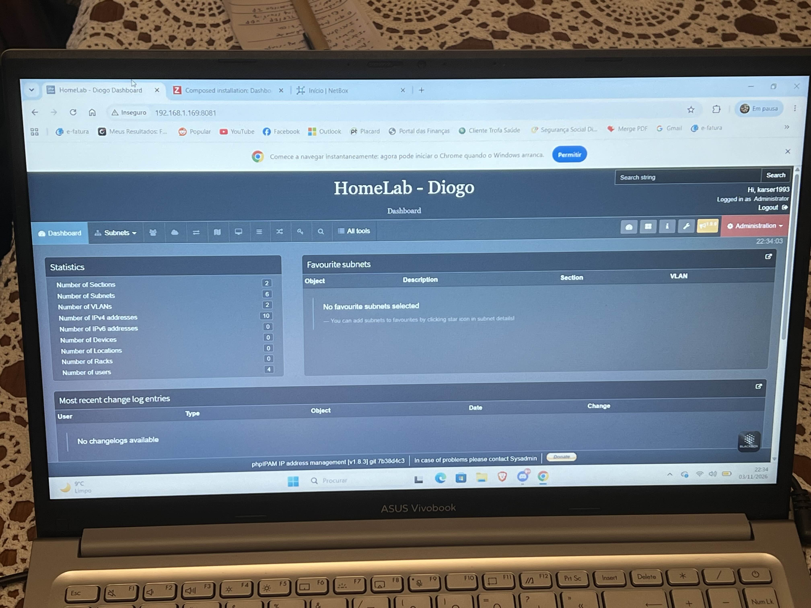

# Acesso Final e Validação da Infraestrutura

Esta pasta representa a fase de conclusão do projeto e a prova real de que o ecossistema de rede e virtualização está totalmente operacional.

## Contextualização e Gestão de Acessos

Antes de testar a conectividade final, foram configurados utilizadores dedicados e as respetivas permissões (roles) para os três serviços core da infraestrutura:
*   **NetBox:** Para documentação centralizada (IPAM/DCIM).
*   **phpIPAM:** Para gestão e planeamento de endereçamento IP.
*   **Zabbix:** Para monitorização ativa de rede e servidores.

A criação destes acessos garante que a infraestrutura está preparada para boas práticas de gestão, separando o que é acesso de administração do que é acesso de consulta.

## Prova de Conectividade (Teste End-to-End)

Para validar que toda a arquitetura de rede (VLANs, switch gerido, servidor virtualizado e port forwarding) está a comunicar corretamente, foi realizado um teste de acesso a partir de dispositivos externos.

Foram utilizados **dois portáteis distintos**, ligados à rede local, que acederam com sucesso aos três serviços alojados no servidor Docker. Esta validação prova que a rede não só está "de pé", como está capaz de servir múltiplos clientes simultaneamente.

## Evidências

### Portátil 1
*   **NetBox (IPAM/DCIM):**
    
*   **Zabbix (Monitorização):**
    
*   **phpIPAM (Gestão de IPs):**
    

### Portátil 2
*   **NetBox:**
    
*   **Zabbix:**
    
*   **phpIPAM:**
    

---
*Nota: A validação cruzada entre os dois portáteis confirma o correto funcionamento das regras de routing e da segmentação de rede implementada nas fases anteriores.*
