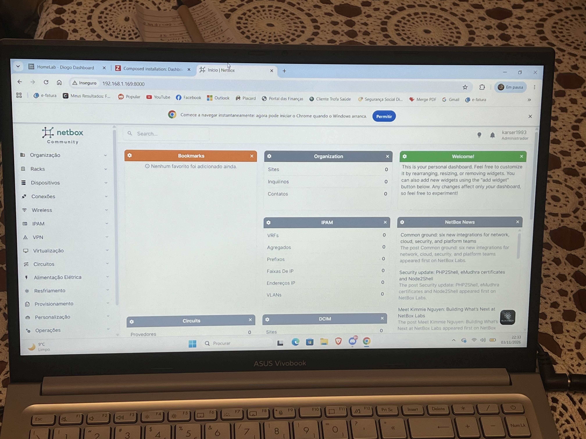
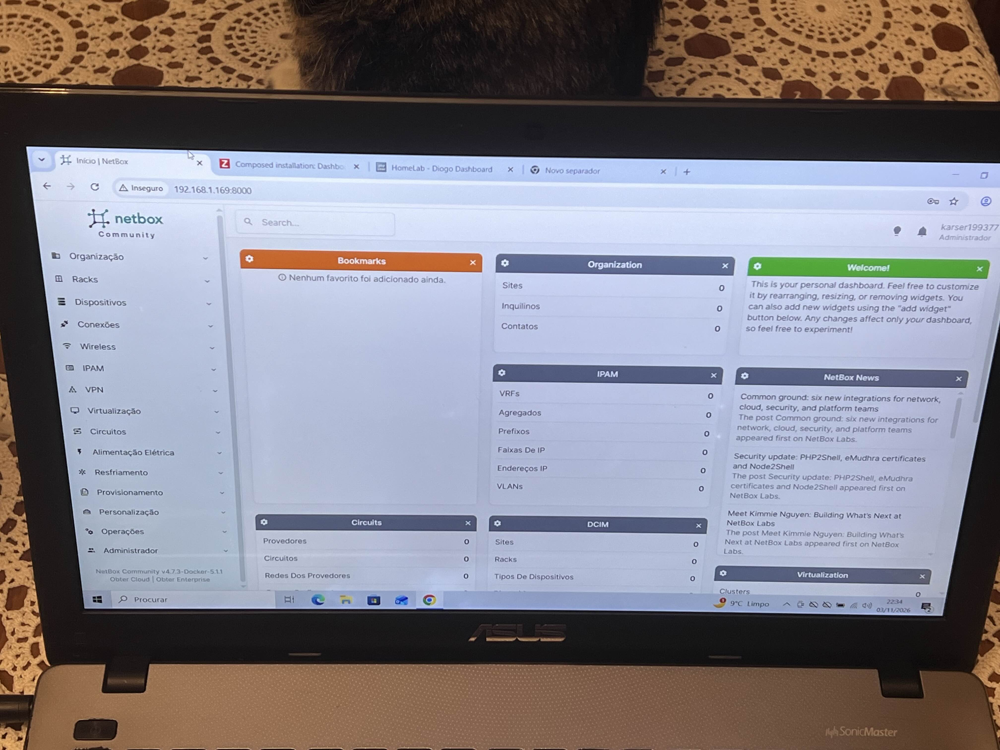
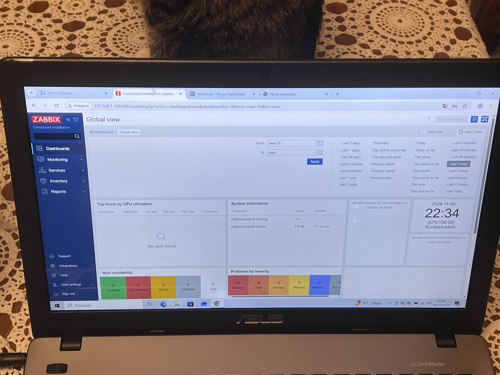
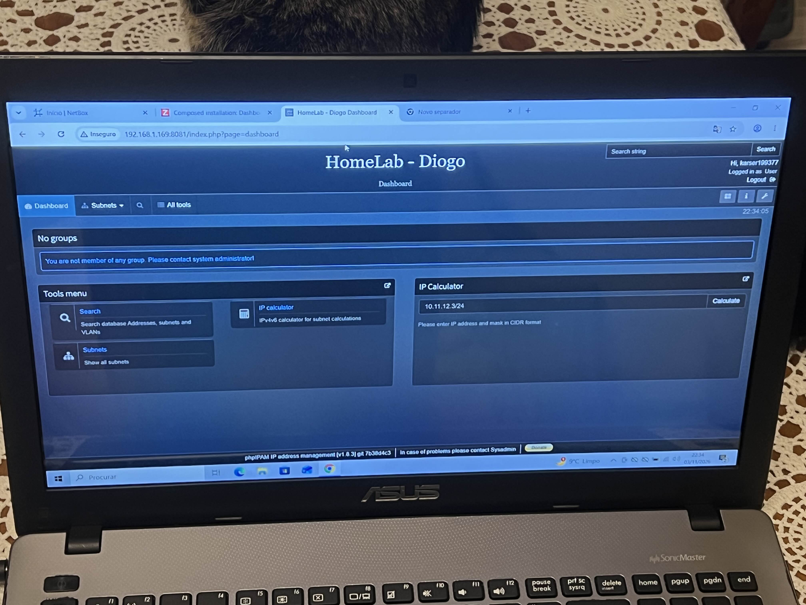

# Acesso Final e Prova de Rede

Esta pasta serve como prova final de que toda a infraestrutura de rede e os serviços implementados estão funcionais e acessíveis a partir de outros dispositivos na rede local.

## O que foi feito nesta fase?

1. **Criação de Utilizadores:** Foram criados utilizadores e definidas as devidas permissões de acesso nos três serviços core da infraestrutura (NetBox, phpIPAM e Zabbix).
2. **Prova de Acesso:** Para validar que a rede está corretamente configurada (incluindo as VLANs e o switch gerido), foram utilizados dois portáteis diferentes ligados à rede. 

## Evidências (Prints dos Portáteis)

Os prints abaixo comprovam o acesso bem-sucedido aos serviços (NetBox, Zabbix e phpIPAM) a partir de cada um dos portáteis:

### Portátil 1
*   
*   
*   

### Portátil 2
*   
*   
*   
