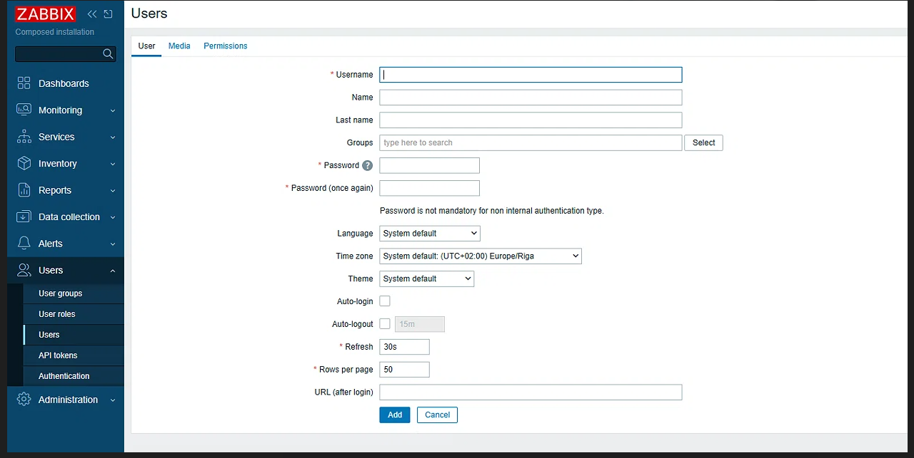
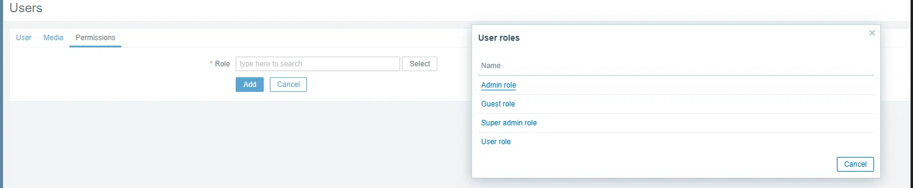

# Gestão de Utilizadores e Acesso Final

Esta secção documenta a criação de contas de utilizador separadas para os portáteis de teste em cada um dos serviços, provando a aplicação de conceitos de controlo de acessos (RBAC - Role-Based Access Control) e a gestão de privilégios.

## A Importância dos Privilégios (Roles)
A principal diferença na criação destas contas é a atribuição do tipo de privilégio (Role). Em vez de darmos permissões de administrador total a todos os utilizadores (o que é uma falha de segurança), aplicámos o Princípio do Menor Privilégio:
*   **Zabbix e NetBox:** Os utilizadores foram criados com permissões normais (Role "User"), pois apenas precisam de visualizar o estado da rede e não devem alterar configurações críticas.
*   **phpIPAM:** Os utilizadores foram criados como "Administrator", pois a sua função é documentar e criar novos endereços IP na rede.

## Zabbix (Utilizador Normal)
No Zabbix, foi criado o utilizador `karser1993`. Para garantir que não tem privilégios de super-administrador, foi-lhe atribuída a Role de "User role".

A segunda imagem mostra o ecrã de permissões (Permissions), onde a Role "User role" é efetivamente aplicada ao utilizador:

## NetBox (Django)
No NetBox, a criação de utilizadores exige o cumprimento de regras de complexidade de passwords (mínimo 12 caracteres). O utilizador foi criado com a caixa "Status de superuser" desmarcada, mantendo-o como utilizador normal.

## phpIPAM (Administrador)
No phpIPAM, o utilizador `karser1993` foi criado com a Role de "Administrator". Como o phpIPAM é usado para documentar e criar os IPs da rede, os portáteis precisam de permissões de escrita nesta ferramenta.

## Conclusão
A criação de contas separadas para os diferentes clientes (portáteis) permite uma gestão de rede mais realista e segura. A atribuição de diferentes níveis de privilégio (Role) para cada ferramenta demonstra uma correta aplicação das boas práticas de segurança de redes.
